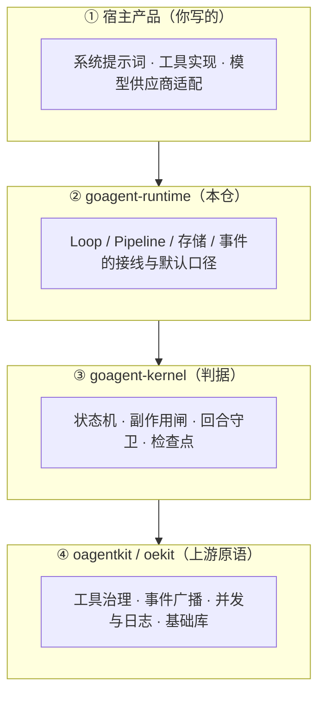

## 它处在哪一层

一句话：**kernel 只管「怎么判定对错」，runtime 负责「把零件装成一辆车」**。你坐在驾驶座上，不用读几十个包。

## 三个模板，按场景选

| 模板 | 存储 | 适用 |
|---|---|---|
| `NewEmbedded` | 内存 | 单进程、测试、内嵌 |
| `NewStandalone` | SQLite 单文件（WAL） | 本机服务，进程重启可恢复 |
| cluster | — | 尚未提供（PG + worker 池，等 kernel 侧压测验证后上） |
