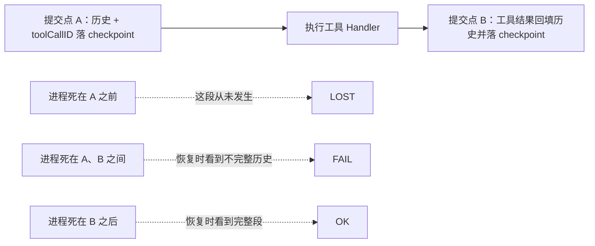
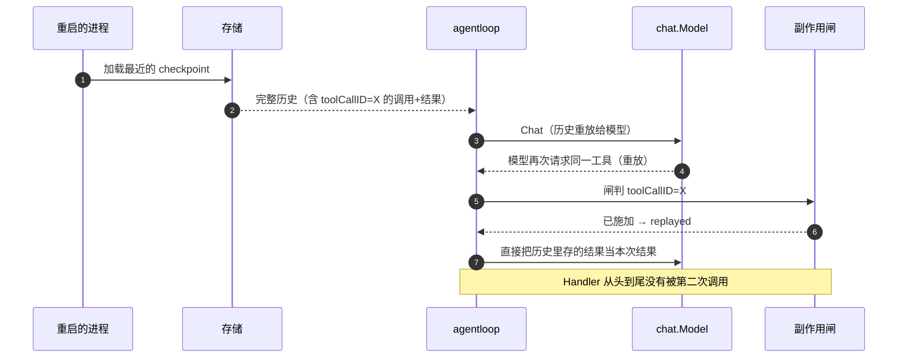
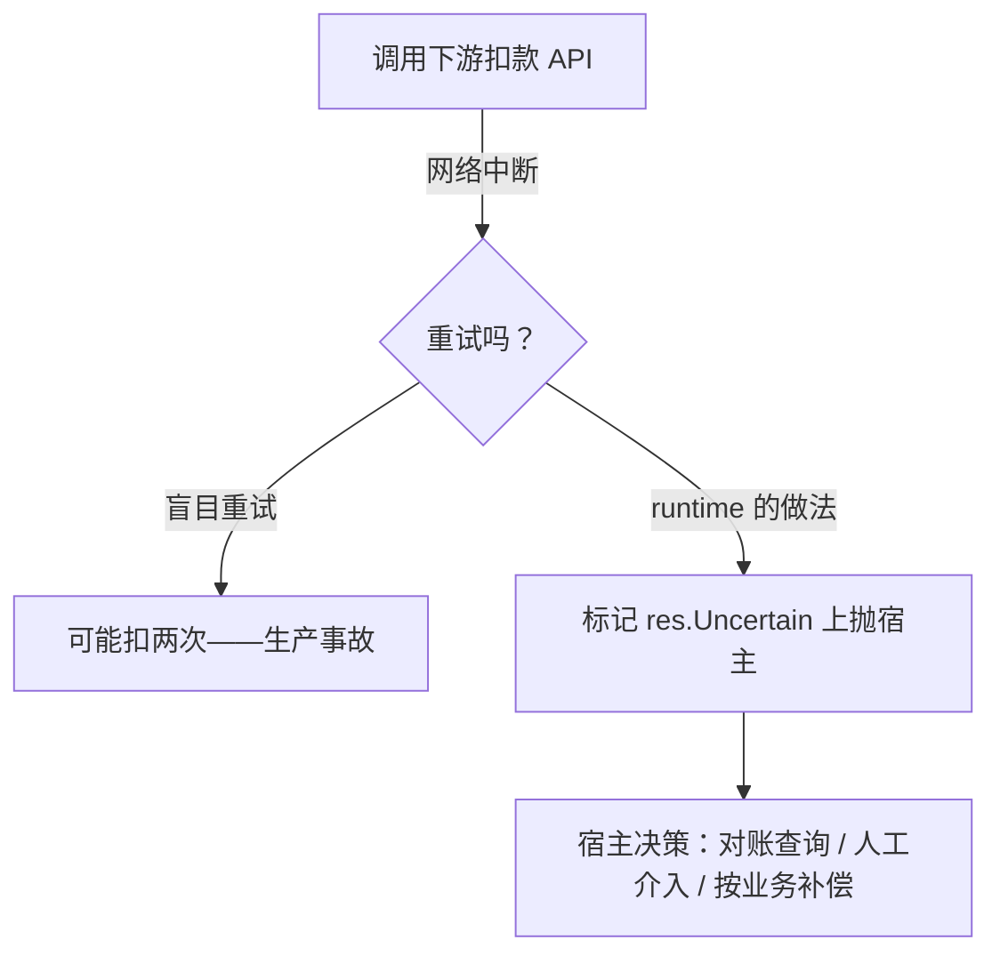

# 中断恢复：完整 walkthrough

这是本仓最重要的进阶页：**进程随时死掉，凭什么保证不丢、不重？**

## 先建立画面：提交点

一次「模型请求工具」的写入分两段顺序代码：

- 死在 A 之前：这次调用从未发生，恢复的历史里**没有这一段**——正确。
- 死在 B 之后：恢复的历史里**完整包含**这一段——继续跑即可。
- 死在 A、B 之间：恢复的历史**不完整**（请求了工具但结果缺失）——这不是正常死法，是存储被外部篡改/实现漂移 ⇒ **fail-closed 报错，不猜**。

## 恢复时的重放判定

假设死在提交点 B 之后、下一个回合之前。重启：

**关键**：模型重放是正常且预期的——它无状态，看到同样的历史就会说同样的话。防重不靠「求模型别重说」，靠 **toolCallID 同键 + 闸判 replayed**。测试里的断言是「施加次数仍为 1」。

## Uncertain：另一种死法

不是进程死，是**工具调远端时失联**：本地不知道远端到底执行了没有。

runtime 的选择永远是后者：**不猜、不盲目重试**。这类结果在存储里被判为「结果未知」态（闸判定序里第二高优先级），等待宿主对账。

## 这一切的测试证据

| 证据 | 覆盖 |
|---|---|
| agentloop / runtime 端到端用例 | 中断→恢复，副作用施加次数仍为 1 |
| kernel sidetest 共享契约（33 子测试 × 内存/SQLite/PG 三遍） | 闸判定序、三项联查、对账占用 |
| PG SIGKILL e2e（integration CI，真 PG） | 提交中途被 SIGKILL，重启恢复且不重放 |

::: warning 边界
这套语义保证「**单个会话**的确定性」。跨会话的全局约束（多 worker 抢同一任务）由 cluster 模板承担（PG + 认领/租约/接管代次）；要跨副本就别拿 standalone 硬扛——SQLite 的锁不是干这个的。
:::
