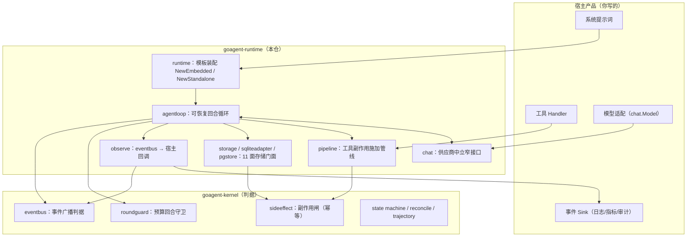
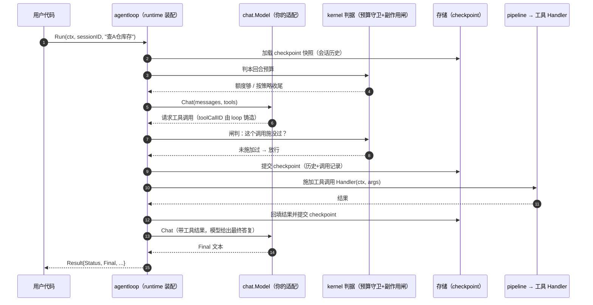
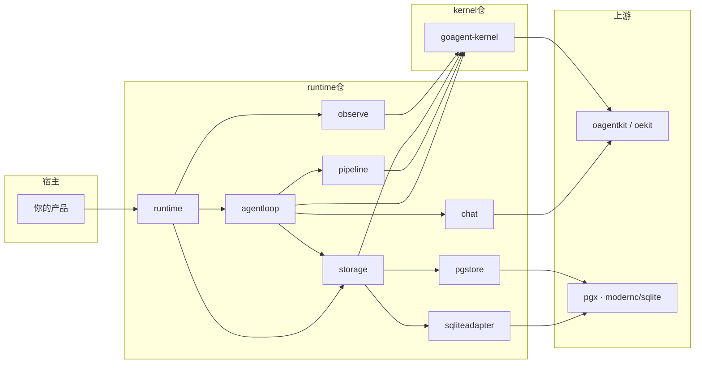
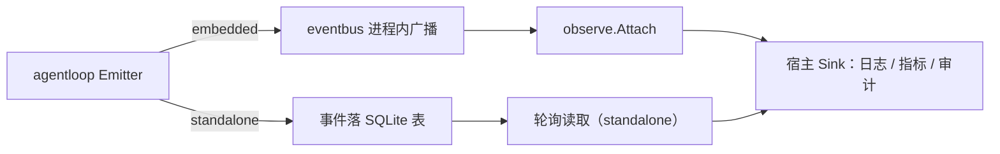

# 架构总览

## 一张图看全家桶

读图要点：

- **箭头向下**：runtime 只依赖 kernel 的**契约**（接口与判据），不依赖任何宿主。
- **箭头向上**：宿主只接触 `runtime.Config`（模型+工具）、`Run` 的结果、和事件 Sink——三个面。
- **storage 的虚线感**：内存/SQLite/PG 三个实现都跑 kernel 的同一套共享测试，判据不分家。

## 一次请求的全链路

以「用户问一句、Agent 调一次工具」为例：

中间任何一步进程死掉，恢复时从 **checkpoint** 继续；已提交过的工具调用在副作用闸前被判 `replayed`，**Handler 不会第二次执行**（详见 [中断恢复](/advanced/recovery.html)）。

## 依赖关系（谁 import 谁）

两条纪律从图上读得出来：

1. **没有环形依赖**——kernel 不认识 runtime，上游不认识任何层。
2. **驱动只在叶子上**——pgx / modernc 只被 sqliteadapter / pgstore 拉进来，主装配面（runtime/agentloop）看不到数据库。

## 事件去哪了

`observe` 是薄装配：订阅并把事件转发给宿主 Sink。不过滤、不采样、不解释语义——那是宿主的事。
