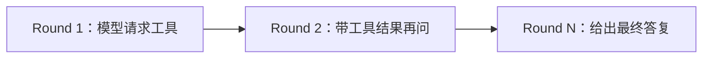
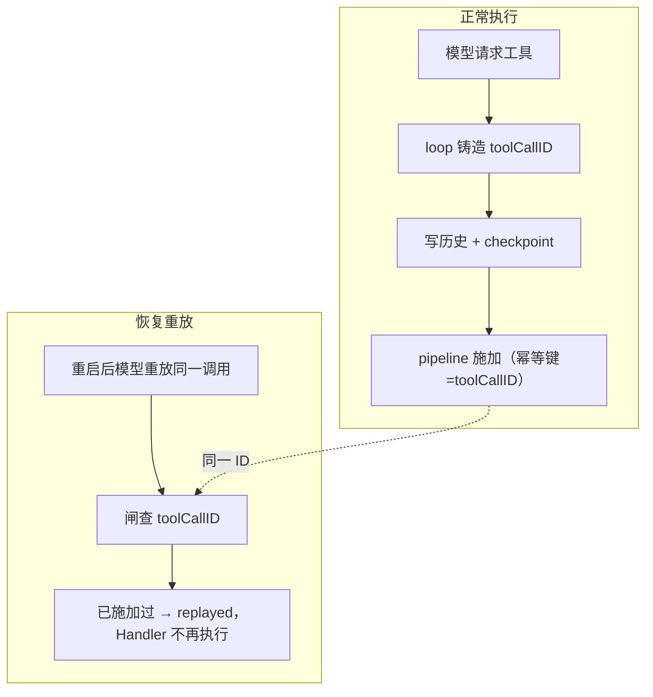

# 核心概念扫盲

这一页把 runtime 里反复出现的名词逐个讲透。每个概念都回答两个问题：**它解决什么事故**、**在代码里长什么样**。

## 回合（Round）

模型和工具的一次完整往返：模型看到历史 → 要么直接给最终答复，要么请求调用工具 → 工具结果回填 → 进入下一回合。



预算（见下）按回合守卫，防止「模型一直调工具停不下来」。

## toolCallID：幂等键的原材料

每个工具调用在被写进历史**之前**，由编排侧（agentloop）铸造一个唯一 ID。它是副作用幂等键的**原材料**：



**为什么不能让模型供应商生成 ID？** 恢复重放时模型可能给出不同 ID——闸会把它当成另一个动作，重复施加的防护就漏了。

## 检查点（Checkpoint）

会话历史整体序列化进快照，在每个提交点落存储：

- 提交点 = 「写历史」和「回填工具结果」这两段**顺序代码**的边界。
- 进程死在任意两个提交点之间 ⇒ 恢复点要么包含完整的「请求 + 结果」，要么两者都不包含。
- 读到**不完整**历史（请求了工具但结果缺失）= 存储被外部篡改或实现漂移 ⇒ **fail-closed 报错，不猜**。

## 副作用闸（sideeffect gate）

kernel 的判据：同一个逻辑动作**至多施加一次**。runtime 的三个存储实现（内存 / SQLite / PG）都实现这面闸，并且全部跑 kernel 的同一套共享测试（33 个子测试，含带凭据裁决）。

闸的判定顺序（契约里最要紧的一行）：

```
已完成 > 结果未知 > 对账中 > 执行中 > 资源被占 > 授予
```

顺序写反的代价是**重复施加**。这也是为什么恢复语义敢承诺「不重放」——承诺的底气在闸上。

## 预算守卫（roundguard）

回合开始前判额度：预算用尽按策略**强制收尾或停止**——不是报错中断，而是让模型体面地结束（把已有结论总结出来）。这避免「预算爆了直接 500」的糟糕体验。

## Uncertain：结果未知

工具执行了，但远端是否真的生效无法确认（网络断了、超时了）。runtime 不猜、不重试，而是把结果显式标记为 `res.Uncertain` 上抛给宿主决策。**盲目重试 = 重复扣款/重复发货**，这是 Agent 生产事故的头号来源。

## 事件（Event）

回合循环全程经 Emitter 出事件：回合开始/结束、工具调用、预算消耗……embedded 模板走进程内 eventbus 广播，standalone 模板落 SQLite 表。宿主通过 `observe` 包把它们接到自己的日志/指标/审计系统。

## fail-closed 总原则

| 情况 | 行为 |
|---|---|
| 模型请求未注册的工具 | 拒绝（OutcomeRefused），绝不猜一个差不多的 |
| 恢复读到不完整历史 | 报错，不猜 |
| 副作用结果无法确认 | 上抛 Uncertain，不盲目重试 |
| 预算用尽 | 按策略收尾，不硬跑 |
