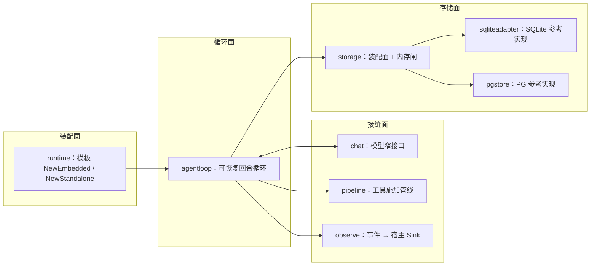
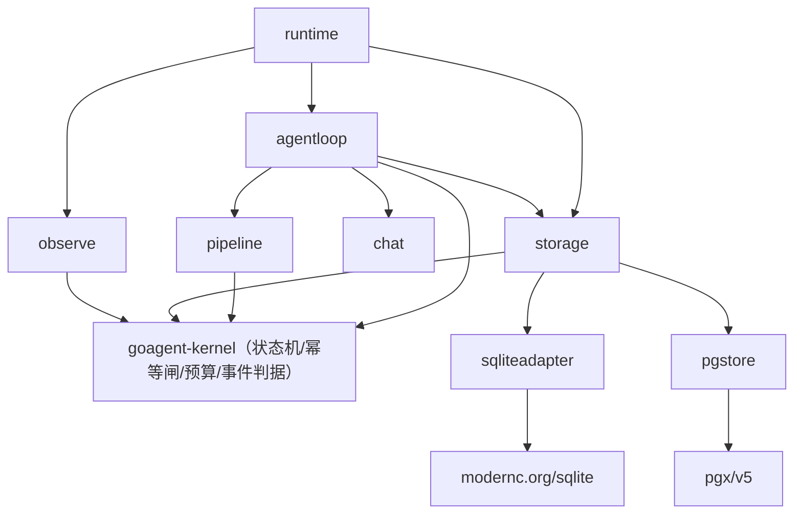

# 包导览

**十个包，一条主线**：runtime 装配 → agentloop 循环 → chat 问模型 / pipeline 调工具 / storage 落存储 / observe 发事件。本页按这条主线讲八个接缝包；`cluster`（多副本模板）与 `containerbackend`（容器后端参考实现）见下表。完整清单与机器事实见「参考 › 机器事实」。

| 包 | 一句话职责 | 详细 |
|---|---|---|
| `chat` | 供应商中立的模型窄接口与消息类型 | [展开](/goagent-runtime/packages/chat.html) |
| `pipeline` | 工具注册与副作用施加（幂等键/资源/重试安全性映射） | [展开](/goagent-runtime/packages/pipeline.html) |
| `agentloop` | 可恢复回合循环（预算守卫 + 检查点 + 事件） | [展开](/goagent-runtime/packages/agentloop.html) |
| `storage` | 存储装配面（内存判据 + SQLite/PG 门面转发） | [展开](/goagent-runtime/packages/storage.html) |
| `sqliteadapter` / `pgstore` | 两个参考实现，11 面统一门面，判据套件同源 | [展开](/goagent-runtime/packages/sqlite-pg.html) |
| `runtime` | 模板装配（embedded / standalone） | [展开](/goagent-runtime/packages/runtime.html) |
| `observe` | eventbus → 宿主回调 | [展开](/goagent-runtime/packages/observe.html) |
| `cluster` | 多副本模板装配（PG + worker 池：认领 / 租约 / 接管代次、跨副本事件面） | [模板选型](/goagent-runtime/templates/) |
| `containerbackend` | 容器执行后端参考实现（Docker / K8s Job）——宿主抄它，不 import 它 | [仓内源码](https://github.com/yi-nology/goagent-runtime/tree/main/containerbackend) |

## 依赖速查

- kernel 不认识 runtime（单向）；驱动只在叶子（pgx / modernc 不进入装配面）。
