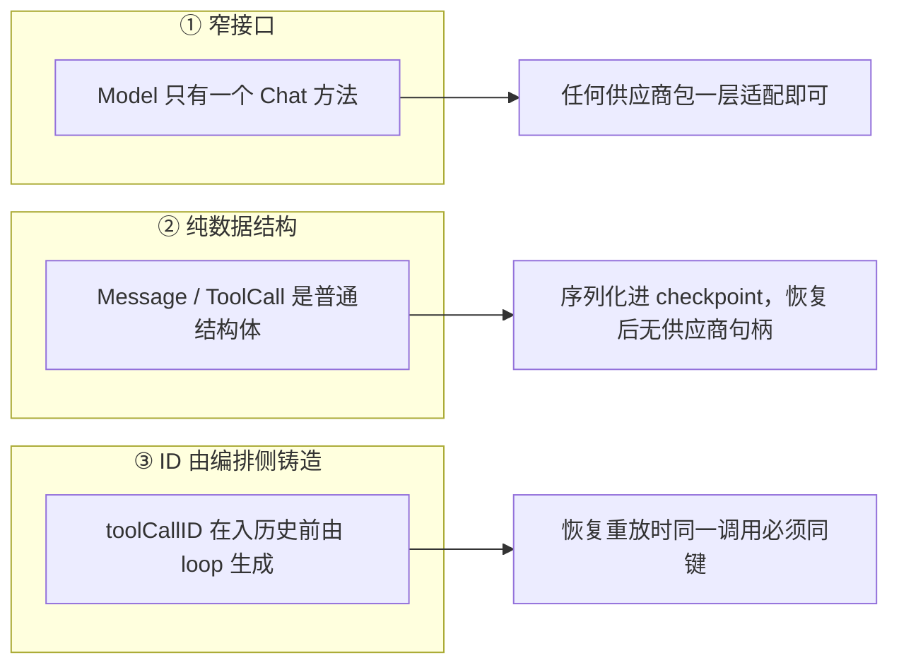
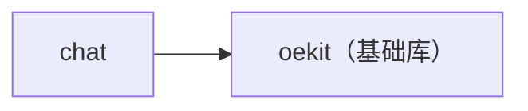

# chat：供应商中立的模型窄接口

**一句话**：定义「模型长什么样」，让任何模型 SDK 都能三行接入。

## 为什么本包存在

kernel 的纪律是「内核不调 LLM」；装配层必须把模型接进来，但接成什么形状决定可测试性与供应商中立性。`chat` 的答案是三个设计：



## 核心类型

| 类型 | 作用 |
|---|---|
| `Model` | 接口：`Chat(ctx, messages, tools) (*Response, error)` |
| `Message` | 消息：角色（system/user/assistant/tool）+ 内容 |
| `ToolCall` | 模型请求的工具调用：ID + 工具名 + 参数 |
| `Response` | 模型答复：要么最终文本，要么一组工具调用 |
| `ToolDecl` | 工具声明（名字/描述/参数 schema），喂给模型 |

角色词表与主流 chat API 同形；本包**只传输、不解释语义**。

## 写一个适配

```go
type myModel struct{ client *openai.Client }

func (m *myModel) Chat(ctx context.Context, msgs []chat.Message, tools []chat.ToolDecl) (*chat.Response, error) {
    // 把 chat.Message 翻成 SDK 类型 → 调远端 → 把响应翻回 chat.Response
}
```

约束只有一条：**不要自己生成 toolCallID**——入历史前 loop 会铸造（见 [agentloop](/goagent-runtime/packages/agentloop.html)）。

## 依赖



只依赖基础库，不认识 kernel、不认识任何供应商——这是最底层的接缝。
