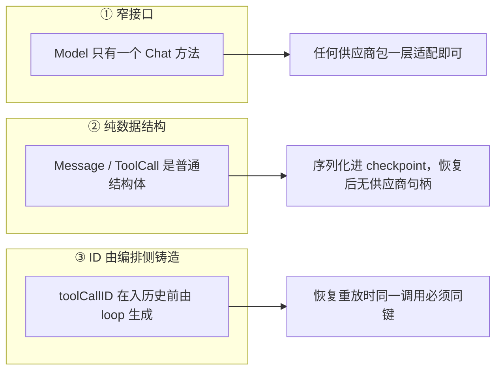
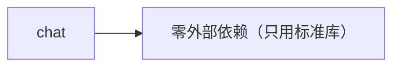

# chat：供应商中立的模型窄接口

**一句话**：定义「模型长什么样」，让任何模型 SDK 都能三行接入。

## 为什么本包存在

kernel 的纪律是「内核不调 LLM」；装配层必须把模型接进来，但接成什么形状决定可测试性与供应商中立性。`chat` 的答案是三个设计：



## 核心类型

| 类型 | 作用 |
|---|---|
| `Model` | 接口：`Chat(ctx, ChatRequest) (ChatResponse, error)` |
| `ChatRequest` | 一次调用请求：`Messages` + `Tools` + 可选的 `OnDelta` 流式回调 |
| `ChatResponse` | 一次调用响应：`Content` 终答文本 + `ToolCalls` 工具请求 |
| `Message` | 消息：角色（system/user/assistant/tool）+ 内容 + 工具调用 + 回填 ID |
| `ToolCall` | 模型请求的工具调用：ID + 工具名 + 参数 JSON 文本 |
| `ToolSpec` | 工具声明（名字/描述/参数 schema），喂给模型 |
| `Delta` | 流式增量片段：kind + text（可选带工具调用片段 / 计量） |
| `DeltaAggregator` | 流式片段归并器：按 Index 归并工具调用、累计计量 |

角色词表与主流 chat API 同形；本包**只传输、不解释语义**。

## 写一个适配

```go
type myModel struct{ client *openai.Client }

func (m *myModel) Chat(ctx context.Context, req chat.ChatRequest) (chat.ChatResponse, error) {
    // 把 req.Messages / req.Tools 翻成 SDK 类型 → 调远端 → 把响应翻回 chat.ChatResponse
}
```

约束只有一条：**不要自己生成 toolCallID**——入历史前 loop 会铸造（见 [agentloop](/goagent-runtime/packages/agentloop.html)）。

## 流式旁路（保流式的宿主怎么用）

`ChatRequest.OnDelta` 是**可选**回调：模型能产流式 chunk 时逐片调用，不支持的实现不调用即可（nil 语义同缺省 ⇒ 非流式宿主零改动）。

```go
func (m *myModel) Chat(ctx context.Context, req chat.ChatRequest) (chat.ChatResponse, error) {
    agg := &chat.DeltaAggregator{}   // 归并规则在框架侧，宿主不再各写一份
    stream, err := m.client.Stream(ctx, req.Messages)
    if err != nil {
        return chat.ChatResponse{}, err
    }
    defer stream.Close()
    for chunk := range stream.Chunks() {
        d := chat.Delta{Kind: chat.DeltaKindText, Text: chunk.Text}
        agg.Add(d)
        req.OnDelta(d)               // 框架侧据此出 content_delta 事件
    }
    return agg.Response(), nil       // 归并后的响应
}
```

要点：

- **归并规则归框架**：`DeltaAggregator` 按 `Index` 归并工具调用片段、累计 usage——这段代码以前每个保流式的宿主各写一遍、各踩各的坑（见 [ADR-0009](/goagent-runtime/adr/ADR-0009-流式接缝走-push-回调加框架归并器.html)）。
- **工具调用片段**：`Delta.ToolCall` 带 `Index`（分组键，≥ 0）、`ID`、`Name`、参数片段；`Delta.Usage` 带 token 计量。
- **响应语义不变**：`OnDelta` 只影响观测面，模型仍返回完整 `ChatResponse`；判据（检查点/预算/恢复）仍在 loop。
- **背压**：事件面广播是非阻塞的（订阅方缓冲满则丢弃并计数）⇒ 宿主 SSE 写慢不会反压模型流。

## 依赖



这是最底层的接缝：只依赖标准库，不认识 kernel、不认识任何供应商——放最底下才不会被任何上层概念污染。
