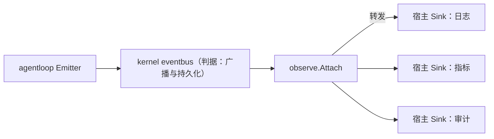

# observe：事件观测薄装配

**一句话**：订阅 eventbus，把事件转发给宿主的 Sink——就这一件事。



## 用法

```go
detach := observe.Attach(ctx, bus, func(ev eventbus.Event) {
    // 打到你的日志 / 指标 / 审计系统
})
defer detach()
```

`sink` 为 nil 是 no-op（返回空 detach 函数），装配层不会替你发明默认后端。

## 明确不做什么

- **不过滤**：想要过滤，Sink 里自己判；
- **不采样**：采样策略是宿主观测系统的事；
- **不解释语义**：事件意味着什么，宿主说了算。

这是装配层的自我克制：只做接线，不发明第二套观测语义。
