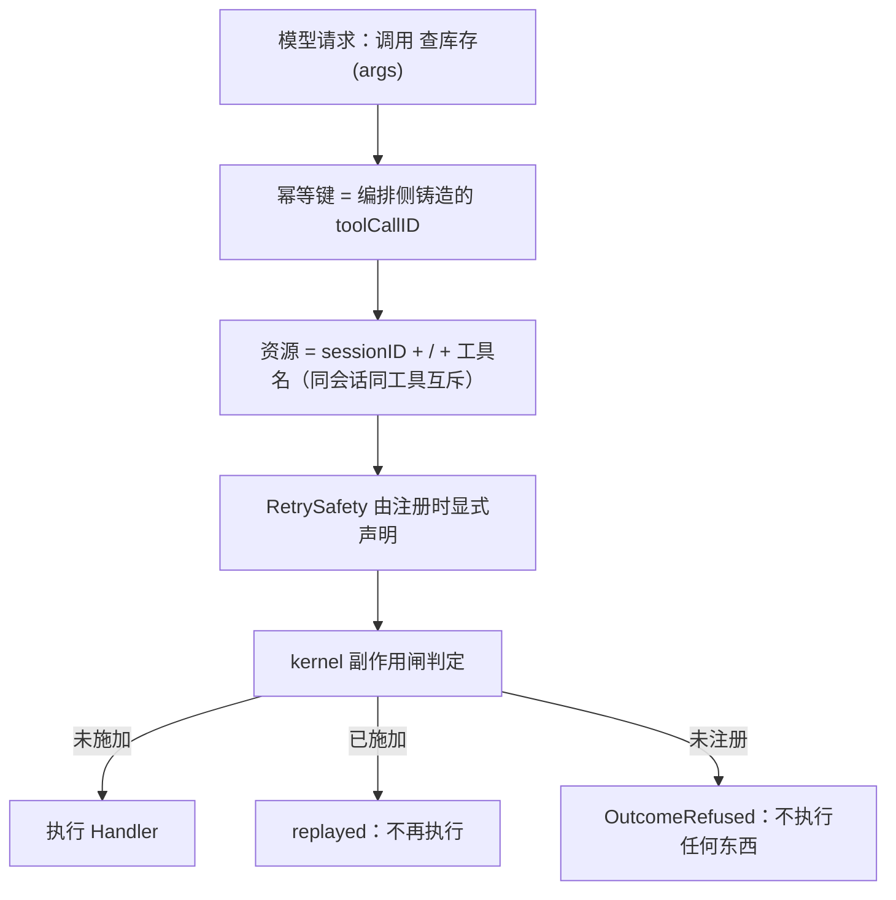
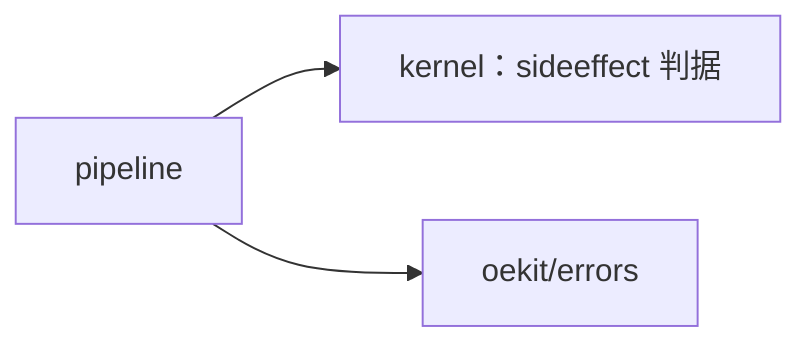

# pipeline：工具副作用施加管线

**一句话**：把「模型说想调工具」变成「副作用至多施加一次」。

## 它补的是哪一段

kernel 的 `sideeffect` 给「同一逻辑动作至多施加一次」的判据，但「一个 Agent 工具调用」到「一条 sideeffect.Action」之间的映射归宿主：幂等键怎么构造？资源怎么划？重试安全性怎么声明？`pipeline` 把这个映射固化成默认口径：



## 三个关键设计

### 1. 幂等键 = toolCallID

恢复重放时，模型会重新「说」同一句话（同一个工具调用）。因为 ID 由编排侧在历史之外铸造，重放必同键——闸认得它，Handler 不会第二次跑。

### 2. 资源 = sessionID + "/" + 工具名

同一个会话里同一个工具的并发施加互斥；不同会话之间互不干扰。

### 3. RetrySafety 显式声明，没有默认值

```go
type Tool struct {
    Name        string
    Description string
    Handler     func(ctx context.Context, args []byte) (string, error)
    // Safe = 宿主断言下游按幂等键去重。
    // 断言错了就是重复施加——只能是注册者的显式选择，不能是默认值。
}
```

**未注册即拒**：模型请求未注册的工具 ⇒ `OutcomeRefused`。判据与 kernel 同方向——要求无满足者即拒绝，绝不降级成「猜一个差不多的」。

## 依赖


