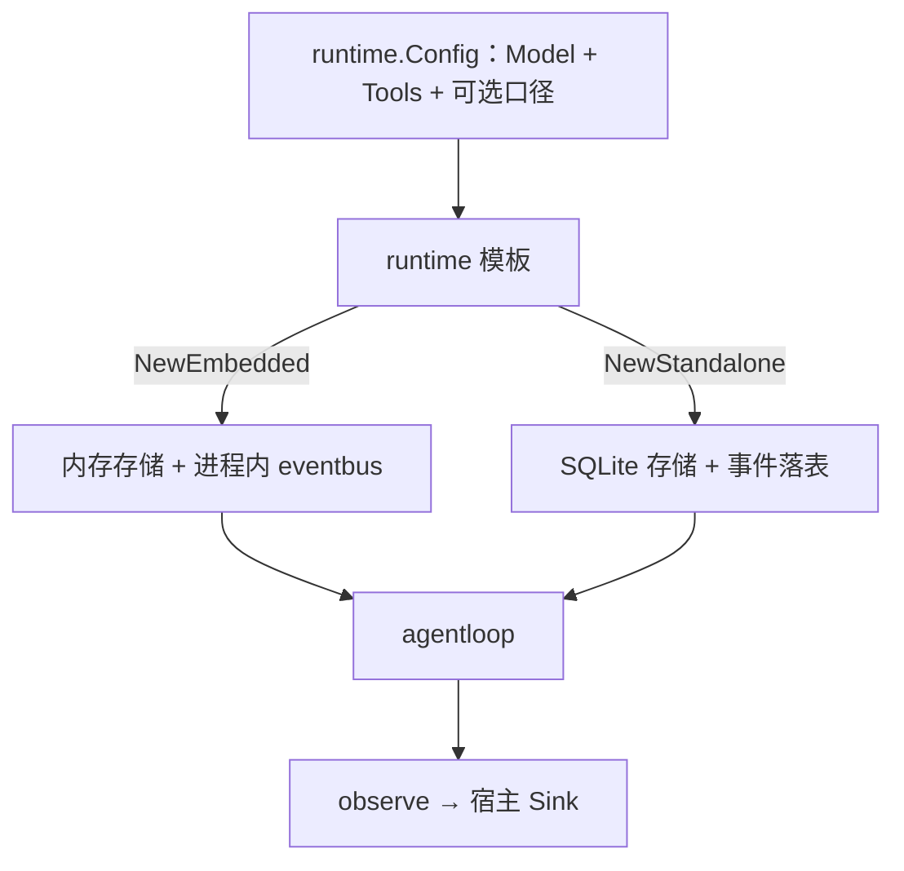

# runtime：模板装配

**一句话**：把上面所有零件装进两个工厂函数，宿主三行代码开跑。

## 装配图



## 最小代码

```go
rt, err := runtime.NewEmbedded(runtime.Config{
    Model: myModel,
    Tools: []pipeline.Tool{{Name: "查库存", Description: "...", Handler: ...}},
})
res, err := rt.Run(ctx, "session-1", "帮我查一下 A 仓库存")
```

`Run` 返回的 `Result`：

| 字段 | 含义 |
|---|---|
| `Status` | 成功 / 预算收尾 / 拒绝 / 出错 |
| `Final` | 模型的最终答复文本 |
| `Rounds` | 跑了几个回合 |
| `ToolCalls` | 发生了哪些工具调用 |
| `Uncertain` | 是否有副作用结果无法确认（见 [中断恢复](/advanced/recovery.html)） |

## 边界（如实声明）

- `NewEmbedded`：内存存储，单进程，零外部依赖——测试/内嵌场景。**进程退出即丢失**。
- `NewStandalone`：SQLite 单文件持久化，本机服务场景。
- **cluster（PG + worker 池）尚未提供**：等 kernel 侧控制面原子审计与租约失格两项 P0 修复、PG 事件面压测过后再上。把未验证的机制固化成默认路径，比没有模板更糟。
