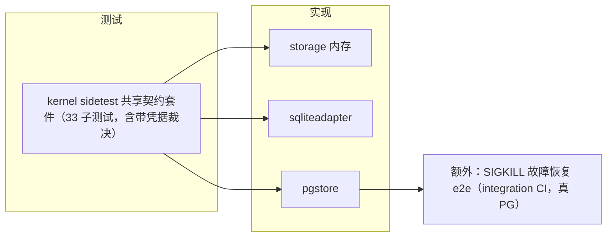
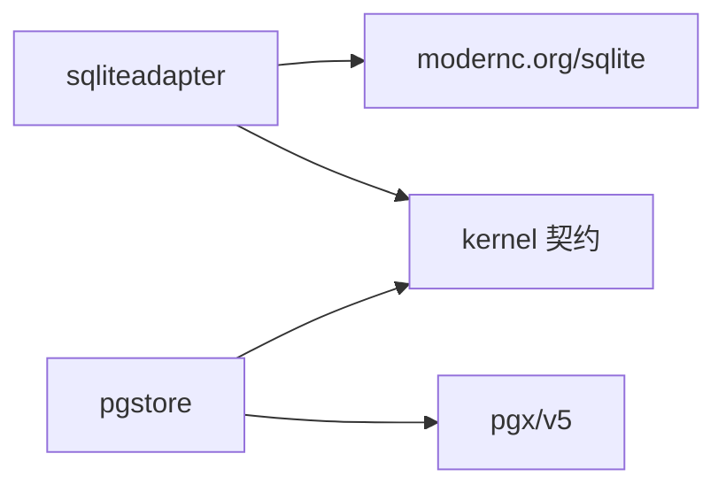

# sqliteadapter / pgstore：两个参考实现

**一句话**：同一套 11 面门面，两个落点——SQLite 负责本机单文件，PG 负责跨进程与未来的 cluster。

## 11 面统一门面

两个实现覆盖同一组存储面（副作用闸 / 会话快照 / 事件 / 游标等 11 个面），**判据套件与 kernel 同源**——不是各写一套测试：

「33 个子测试跑三遍」是刻意的：同一个判据，三个实现各自证明一遍——内存版证语义，SQLite 版证跨进程文件语义，PG 版证真数据库故障语义。

## 选型

| | sqliteadapter | pgstore |
|---|---|---|
| 依赖 | `modernc.org/sqlite`（纯 Go，CGO 不需要） | `pgx/v5` |
| 部署形态 | 单文件（WAL），跟进程走 | 独立 PG 服务 |
| 适用 | 本机服务、单机工具、边缘 | 多副本、未来的 cluster 模板 |
| 证据 | 共享契约套件 | 共享契约套件 + **SIGKILL e2e**：测试进程在提交中途被 SIGKILL，重启后恢复且副作用不重放 |

::: warning 驱动纪律
这两个包是**唯一**拉数据库驱动的位置（看依赖图：pgx / modernc 只出现在这两个叶子）。装配面（runtime/agentloop）看不到任何数据库——这正是当年把参考实现从 kernel 迁出来的原因：kernel 的门禁要求「内核不拖存储驱动」。
:::

## 依赖

