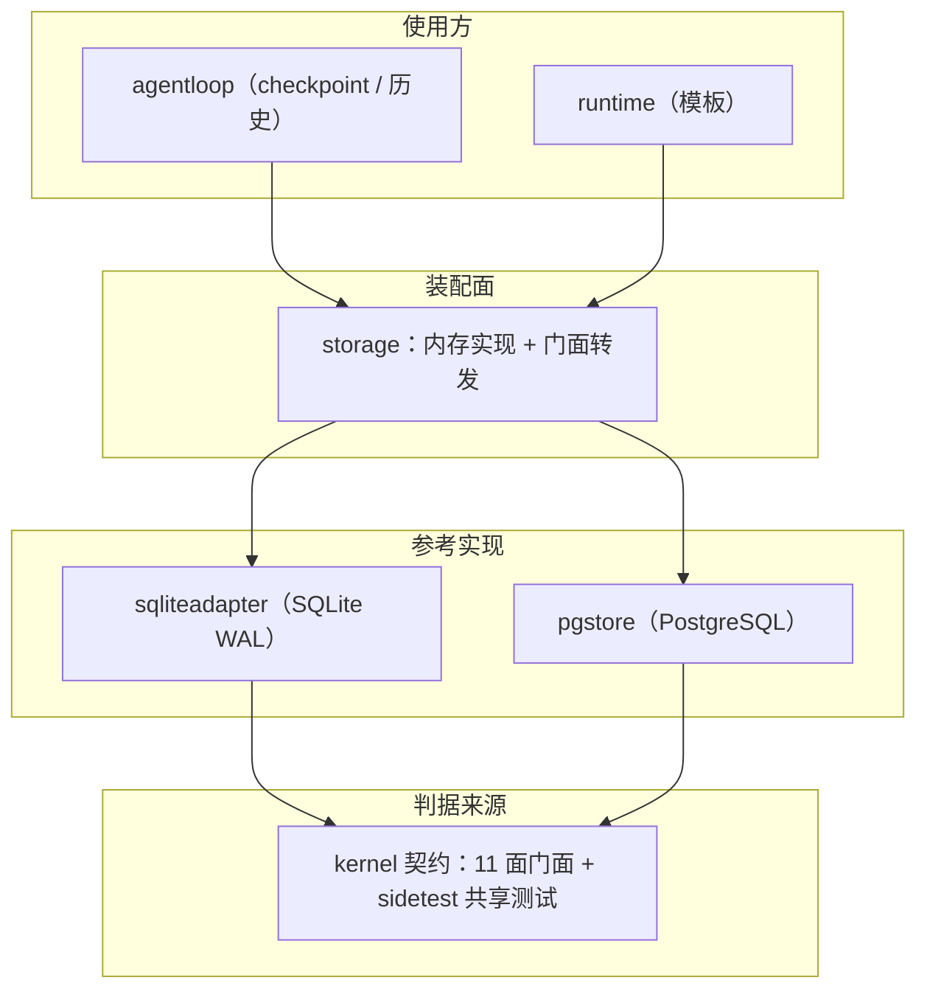
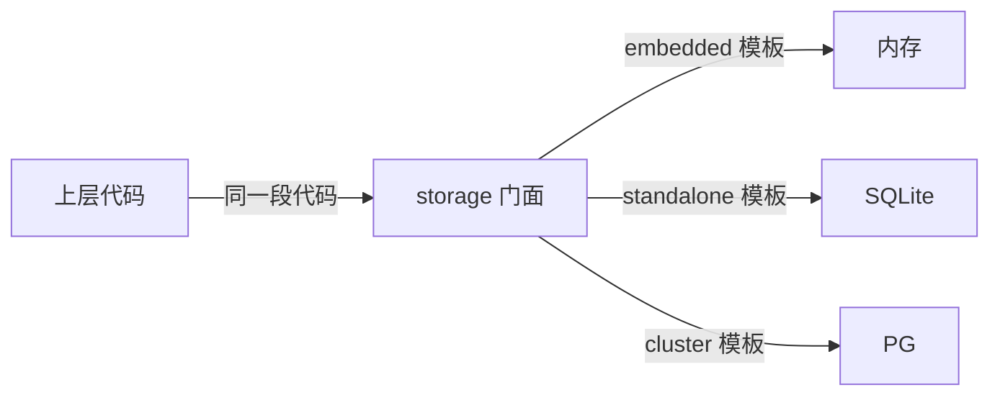

# storage：存储装配面

**一句话**：给上层一个统一的存储面——内存判据在此，SQLite/PG 参考实现通过门面转发。

## 三层的存储关系



## 内存实现的三条判据

内存副作用闸（`memEffectStore`）的判据移植自 kernel 的参考运行时，钉住三条：

1. **三项联查**：令牌 + 持有者身份 + 资源一致才算数；
2. **执行意图**：Acquire 原子登记，过期未裁决转未知态；
3. **对账占用**：单对账者，过期可重入。

Acquire 判定顺序是契约里最要紧的一行：

```
已完成 > 结果未知 > 对账中 > 执行中 > 资源被占 > 授予
```

**顺序写反的代价是重复施加。** 原子性来自进程内互斥锁——只在单进程内成立，所以才有 SQLite/PG 两个跨进程实现。

## 门面转发的意义



换模板不改业务代码——模板切换是存储面的配置，不是上层的改动。
