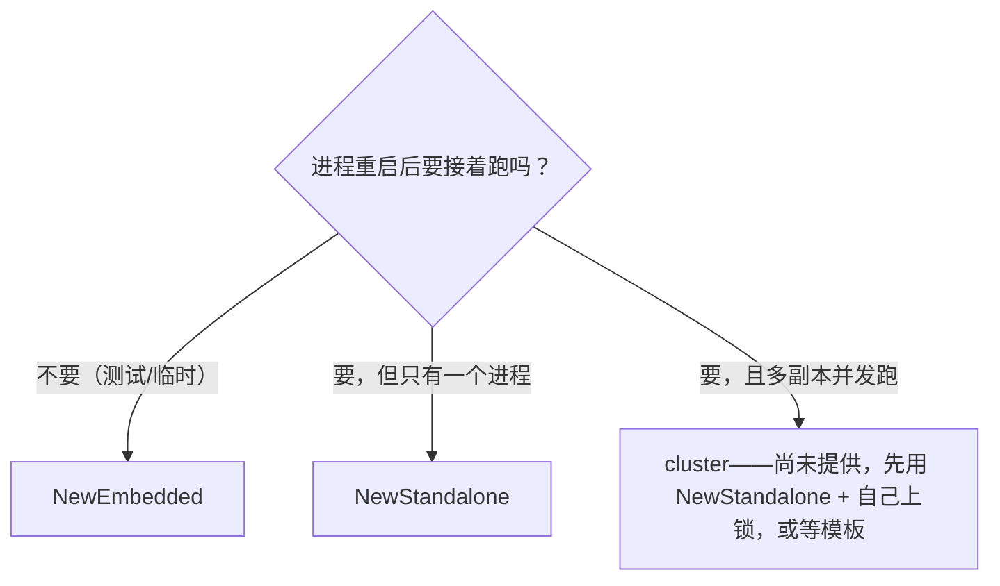
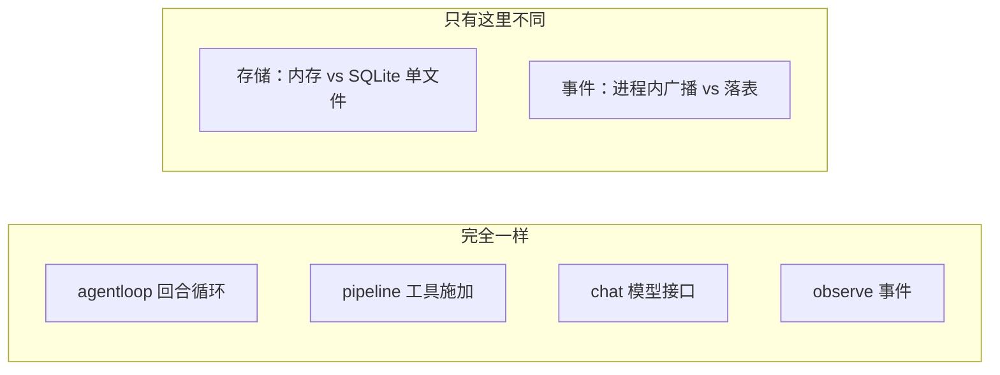

# 模板选型

**一句话**： embedded 全内存零依赖；standalone 多一个 SQLite 文件换进程重启可恢复。

## 对比

| | `NewEmbedded` | `NewStandalone` | cluster |
|---|---|---|---|
| 存储 | 内存 | SQLite 单文件（WAL） | — |
| 进程重启 | 丢失 | **可恢复** | — |
| 外部依赖 | 无 | 无（纯 Go SQLite，CGO 不需要） | PG 服务 |
| 适用 | 测试、内嵌、一次性脚本 | 本机服务、CLI 工具、边缘单点 | 多副本 worker 池 |
| 状态 | ✅ 可用 | ✅ 可用 | ⏳ 未提供 |

## 决策树

::: warning 为什么 cluster 宁可没有也不先给个「差不多能用」的
cluster 要回答的问题和单机完全不同：多 worker 抢同一任务怎么裁决、存储故障时租约怎么不失效、事件怎么跨副本不丢不重。kernel 侧的控制面原子审计与租约失格两项 P0 修复、PG 事件面压测未验证之前给模板，等于把未验证的机制固化成默认路径——**比没有模板更糟**。
:::

## 两个模板共享什么

切换模板是 `NewEmbedded(cfg)` → `NewStandalone(cfg, "/path/x.db")` 的一行改动，业务代码零改动。
