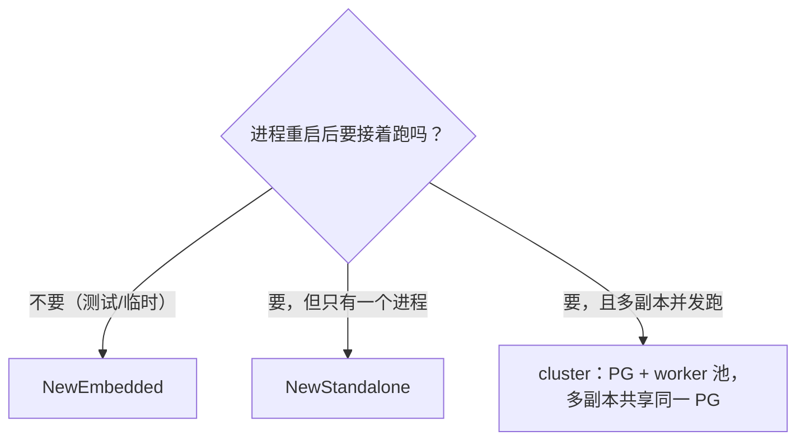
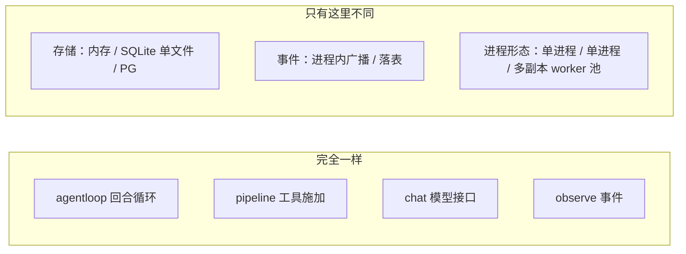

# 模板选型

**一句话**： embedded 全内存零依赖；standalone 多一个 SQLite 文件换进程重启可恢复；cluster 把同一份 PostgreSQL 交给多个副本，多副本共享任务与会话。

## 对比

| | `NewEmbedded` | `NewStandalone` | cluster |
|---|---|---|---|
| 存储 | 内存 | SQLite 单文件（WAL） | PostgreSQL（多副本共享） |
| 进程重启 | 丢失 | **可恢复** | **可恢复**（副本重启后由别的副本接管任务） |
| 外部依赖 | 无 | 无（纯 Go SQLite，CGO 不需要） | PG 服务 |
| 适用 | 测试、内嵌、一次性脚本 | 本机服务、CLI 工具、边缘单点 | 多副本 / 高可用 worker 池 |
| 前置 | — | — | kernel 两项 P0 已修（控制面原子审计 v0.64.3、租约失格 v0.64.1） |
| 状态 | ✅ 可用 | ✅ 可用 | ✅ 可用 |

## 决策树

::: tip cluster 的能力、前提与证据
**能力**：多个副本共享一个 PostgreSQL；任一副本可接单可执行；同一会话在集群内**有且只有一个副本执行**（认领 + 租约 + 接管代次，走 kernel `taskboard` 判据）；副本崩了任务由别的副本接手；结果经 PG 事件面跨副本回传。

**前提**：接管重跑要「不重复施加副作用」，靠宿主声明**业务幂等键**（订单号这类稳定键）——这是结构性保证，不再依赖模型复述同一个 `tool_call_id`；未声明时沿用编排侧铸造的 `toolCallID`，跨副本这一步就依赖模型给出稳定 ID。

**证据**：集成用例跑真 PostgreSQL——两个独立副本抢同一会话时工具只被施加一次；副本领了任务却不收场（模拟被 SIGKILL）后另一副本接管，已施加的副作用不再施加。CI 的 integration job 提供真 PostgreSQL 跑这批用例。
:::

## 三个模板共享什么

切换模板是 `NewEmbedded(cfg)` → `NewStandalone(cfg, "/path/x.db")` 的一行改动，业务代码零改动；换 cluster 是 `cluster.New(ctx, cfg, dsn)`——多一句 PG 连接串，多副本形态由它自己协调（宿主只管投递与等待）。
