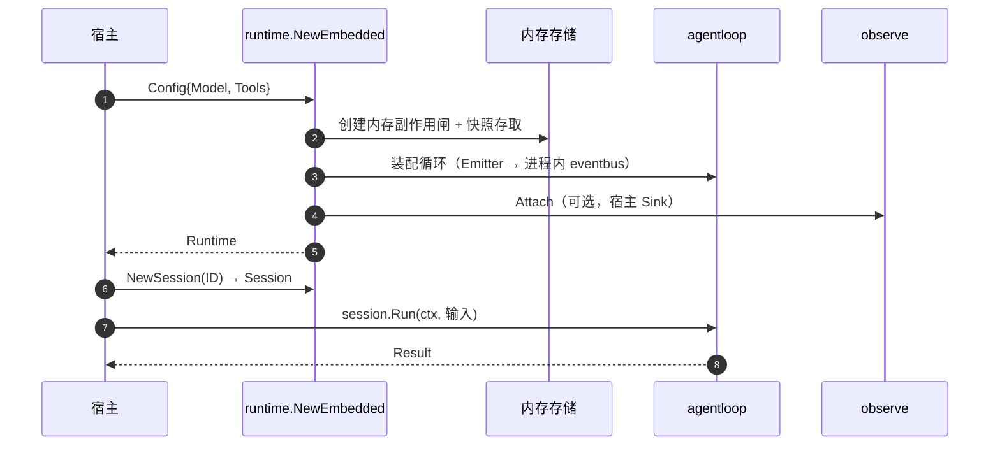

# embedded 模板

**适用**：测试、内嵌进别的程序、一次性脚本——任何「进程退出即丢弃」的场景。

## 装配



## 特点

- **零外部依赖**：不碰磁盘、不开端口，单元测试里随便造；
- **事件走进程内 eventbus**：同进程订阅者即时收到；
- **恢复语义只在进程存活期内成立**——退出即丢，这是 by design。

## 代码

```go
rt, err := runtime.NewEmbedded(runtime.Config{Model: m, Tools: tools})
session, err := rt.NewSession(ctx, runtime.SessionOptions{ID: "session-1"})
res, err := session.Run(ctx, "查一下 A 仓库存")
```
