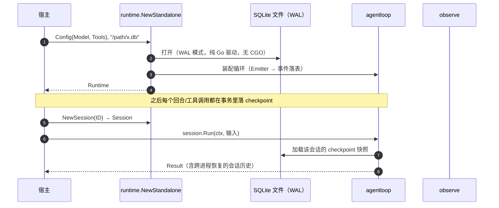

# standalone 模板

**适用**：本机服务、CLI 工具、边缘单点——「进程重启后要接着跑」的单机场景。

## 装配



## 特点

- **跨进程恢复**：进程死掉重启，从 SQLite 里恢复会话历史，已施加的副作用不重放；
- **事件落表**：观测方可以另一个进程读表消费；
- **零运维**：单文件跟进程走，备份 = 拷贝文件。

## 代码

```go
rt, err := runtime.NewStandalone(runtime.Config{Model: m, Tools: tools}, "/var/lib/myapp/agent.db")
session, err := rt.NewSession(ctx, runtime.SessionOptions{ID: "session-1"})
res, err := session.Run(ctx, "接着上次的问题继续")
```

::: tip 与 embedded 的关系
除存储与事件通道外，两个模板共享全部装配（循环/施加/观测）。这也意味着 embedded 的测试证据（同一套判据用例）对 standalone 大部分成立——差异只在存储那 11 个面的实现上，而那部分由共享契约套件单独钉住。
:::
